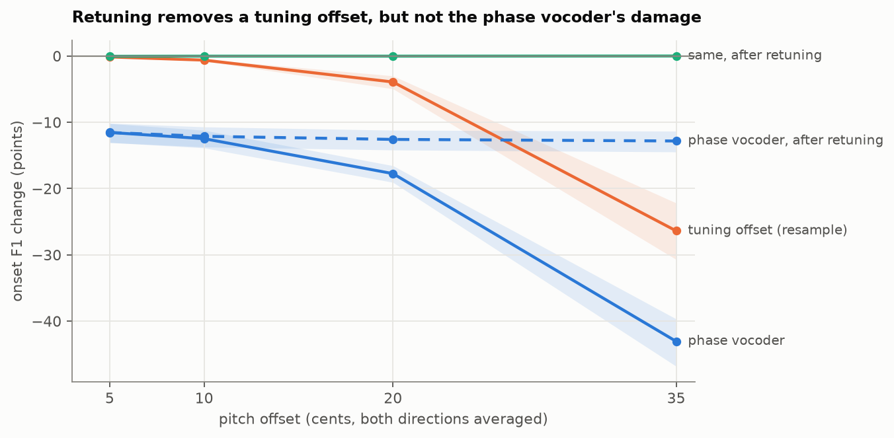

# piano-tuning

[](https://github.com/Juhani1104/piano-tuning/actions/workflows/ci.yml)
[](https://www.python.org/)
[](https://pytorch.org/)
[](https://magenta.tensorflow.org/datasets/maestro)
[](#results)
[](LICENSE)
[](requirements.txt)
[](https://github.com/astral-sh/ruff)
[](https://github.com/Juhani1104/piano-tuning/commits/main)

**A piano tuned off A440 can break a transcriber. Retune the audio first.**

A piano tuned a little sharp or flat moves every note away from the pitches a
transcription model was trained on. This repository measures how much that costs three
pretrained piano transcribers, and shows that estimating the offset and resampling it
away before inference (no retraining) brings them back to their original scores.

<p align="center">
  
</p>

<sub>Kong et al.'s transcriber on 30 MAESTRO pieces (first 90 s each), with 95% bootstrap
intervals over pieces. Retuning removes a tuning offset completely, but cannot remove
the damage of a phase-vocoder pitch shift.</sub>

- **Small offsets are harmless, large ones are not.** At 10 cents Kong loses 0.6 onset
  F1 points; at 35 cents it loses 26, and Basic Pitch 28.
- **Retuning fixes it without retraining.** Up to ±35 cents, all three models come back
  to within 0.3 points of their scores on the original audio, and retuning audio that
  was never shifted costs at most 0.23. Five seconds of audio is enough to estimate the
  offset.
- **A published robustness drop is the phase vocoder.** Edwards et al. (2024) report
  that Kong loses 11.6 points under a random ±10 cent shift. Here a phase vocoder gives
  −11.39, while a plain resample gives −0.29. The vocoder's loss comes from shifted
  onsets and extra notes, not from pitch.

## How it works

1. **Detune.** A resample changes pitch and speed together, like a piano tuned off
   A440 or a tape played at the wrong speed, and the reference onsets are rescaled to
   match. A phase vocoder (librosa, the audiomentations default before 0.39) changes
   pitch at fixed length, as most robustness tests do.
2. **Estimate.** `librosa.estimate_tuning` measures the offset in cents (mean error
   1.2–1.3 cents on these pieces).
3. **Retune.** The audio is resampled by the opposite amount, the model runs on it, and
   note times are mapped back.
4. **Score.** `mir_eval` onset-only note F1 at 50 ms and 50 cents.

## Results

| Experiment | Headline | Evidence |
|---|---|---|
| Kong, 30 pieces | tuning offset 10 / 20 / 35 cents: −0.63 / −3.93 / −26.39 onset F1; retuned: −0.03 / −0.03 / −0.01 | [`summary.txt`](results/summary.txt) |
| Transkun and Basic Pitch, 10 pieces | Transkun 35 cents −1.48, Basic Pitch −27.90; retuned: both within 0.3 | [`summary2.txt`](results/summary2.txt) |
| Real offset: Studio MAESTRO, 30 pieces | the studio piano sits at +8.5 cents (4.5 to 12.0); retuning gives Kong +0.66 [0.45, 0.88], 25 of 30 pieces better | [`summary3.txt`](results/summary3.txt) |
| Against augmented training (10 pieces) | Edwards et al.'s model, trained with ±10 cent shifts, still loses 20.98 at 35 cents; retuning brings it back to −0.00 | [`summary3.txt`](results/summary3.txt) |
| Published drop (Edwards et al., ±10 cents) | phase vocoder −11.39 (MAESTRO) and −17.41 (Studio), against −11.6 and −19.2 published; resample −0.29 and −1.34 | [`replicate.txt`](results/replicate.txt) |
| Why the vocoder hurts | onsets move by +16 ms and 71 extra notes appear per piece; the best constant lag recovers only 83.9 → 88.1 of 96.5 | [`summary3.txt`](results/summary3.txt), [`vocoder_lag.txt`](results/vocoder_lag.txt) |
| Estimation window | median error 1.5 cents from 5 s of audio; 3.9% of 5 s windows are off by more than 5 cents | [`window.txt`](results/window.txt) |
| How often real songs are off (FMA small, 7994 clips) | 30.0% are off by more than 10 cents, 16.6% by more than 20, 6.4% by more than 35 (upper bounds) | [`summary_fma.txt`](results/summary_fma.txt) |

For scale: A4 = 442 Hz is +7.9 cents, 443 Hz is +11.8, and 432 Hz is −31.8.

## Reproducing

Install the pinned packages in [`requirements.txt`](requirements.txt), then Transkun
and Basic Pitch with `pip install --no-deps` (their own dependencies pull in sox and
TensorFlow). A CUDA GPU makes the transcription runs practical. Run every script from
the repository root as `python -I src/<script>.py`.

| Level | Command | Needs |
|---|---|---|
| Redraw the figure and summaries | `python src/make_figure.py`, `python src/analyze.py` (and `analyze2`, `analyze3`, `analyze_fma`) | this repo |
| Rerun everything | the steps below, in order | MAESTRO, Studio MAESTRO and FMA small, read with range requests |

<details>
<summary>Step → script → result file</summary>

| Step | Script | Result |
|---|---|---|
| Download the 30 MAESTRO test pieces | `src/get.py` | `data/` (piece list in `data/pick.json`) |
| Kong under every offset, with retuning | `src/run_kong.sh` (`exp.py`, `analyze.py`) | `results/exp.json`, `results/summary.txt` |
| Transkun and Basic Pitch | `src/run_models.sh` (`exp2.py`, `analyze2.py`) | `results/exp2.json`, `results/summary2.txt` |
| Edwards's model and Studio MAESTRO | `src/get2.py`, then `src/run3.sh` (`smoke.py`, `exp3.py`, `analyze3.py`) | `results/exp3.json`, `results/summary3.txt` |
| Published drop | `src/replicate.py` | `results/replicate.txt` |
| Vocoder delay | `src/vocoder_lag.py` | `results/vocoder_lag.txt` |
| Estimation window | `src/window.py` | `results/window.txt` |
| FMA survey | `src/fma_tuning.py`, `src/analyze_fma.py` | `results/fma_tuning.json`, `results/summary_fma.txt` |
| Figure | `src/make_figure.py` | `docs/retune.png` |

</details>

`exp.py` resumes from `results/exp.json`. Its first ten pieces were also run at ±50
cents and with signalsmith-stretch; those rows are kept in the file, and the rest of
the run dropped them to finish in time.

## Repository layout

```
src/       downloads, experiments, analysis and the figure
results/   raw results (.json) and summaries (.txt)
data/      piece lists (audio, MIDI and model weights are downloaded, not in git)
docs/      figure
```

## Limitations

- Small scale: 30 pieces for Kong, 10 for Transkun and Basic Pitch, first 90 s each.
- Near ±50 cents the direction is ambiguous (half a semitone), and retuning moves half
  the notes the wrong way (Kong still loses 42.6). An offset of about a semitone, such
  as A4 = 415 Hz, looks in tune to the estimator.
- The FMA estimates are not validated on mixed, non-piano music, so the shares are
  upper bounds.
- Using a phase vocoder is an inference about Edwards et al.: their paper does not state
  the audiomentations version, but both of their reported drops match it.

## Related

[tsm-confound](https://github.com/Juhani1104/tsm-confound) extends the phase-vocoder
finding to six tools, six tasks and seven models.

## License

Code and result files: MIT. See [LICENSE](LICENSE). MAESTRO and Studio MAESTRO are
CC BY-NC-SA 4.0 and FMA tracks carry their own Creative Commons licenses; no audio is
redistributed here.
